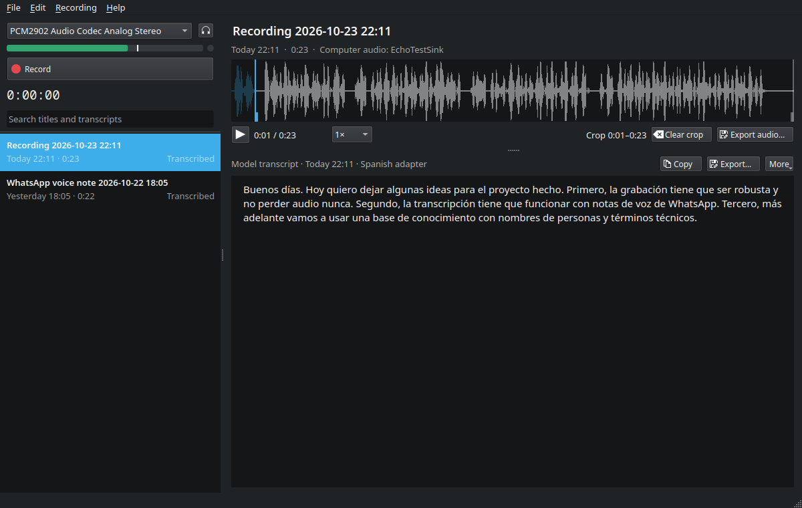

<p align="center">
  
</p>

<h1 align="center">Echo</h1>

<p align="center">
  Record long talks and voice notes, and get Spanish transcripts made on your own computer.
</p>

<p align="center">
  
</p>

Echo is a desktop app for Linux. It records from any microphone, or from whatever the computer
is playing, imports audio from anywhere (WhatsApp voice notes included), and transcribes
Spanish speech on your own computer, on an NVIDIA or AMD graphics card or on the processor.
Nothing is uploaded: after a one-time model download it works offline.

It is made for long, unscripted speech: thinking out loud, interviews, meetings, hours of
voice notes.

## What it does

- **Records without losing audio.** Recording runs in its own background process and is saved
  to disk every two seconds. Closing the window, a crash or a power cut loses nothing that
  reached the disk, and the next start recovers the recording by itself. Finished recordings
  are lossless FLAC, kept only after Echo checks they decode to exactly what was captured.
- **Records both sides of a call.** Turn on "Computer audio" and Echo records your microphone
  and what the computer plays (Meet, Teams, Zoom) at the same time, as two tracks of one
  recording. The call app keeps its microphone and sound as usual, and the transcript knows
  which side said what.
- **Transcribes long recordings well.** Speech is split at natural pauses into passages and
  paragraphs with timing, punctuation and accents. A recent graphics card transcribes an hour of
  audio in about a minute; a recent desktop processor in five to ten.
- **Imports anything.** Drag files or folders onto the window. WhatsApp voice notes (`.opus`,
  `.m4a`, `.amr`) are recognized and dated from their names, and duplicates are skipped.
  Screen recordings and other videos (`.mp4`, `.mkv`, `.mov`, …) bring only their sound: a
  40-minute OBS meeting becomes a 57 MB recording in a few seconds, at full quality.
- **Lets you work with the text.** Click a recording to read its transcript, edit it (edits
  save automatically and are never overwritten), search every transcript at once, show when
  each passage starts, copy it with or without times, export it as text, Markdown, subtitles
  (SRT, VTT) or JSON, and Ctrl+click a passage to hear it.
- **Plays and crops.** A waveform with speed and volume controls (up to 400% for quiet
  meetings) and non-destructive crop that snaps to pauses.
- **Keeps your files plain.** Each recording is a folder with its audio, a `meta.json` and its
  transcripts.

Transcription uses [Cohere Transcribe](https://huggingface.co/CohereLabs/cohere-transcribe-03-2026)
with the [Surus Spanish adapter](https://huggingface.co/surus-ai/cohere-transcribe-spanish-MegaASR).

## Requirements

- Linux with PipeWire (the default on current Fedora, Ubuntu, Debian and Arch desktops)
- `ffmpeg`
- [`uv`](https://docs.astral.sh/uv/), which installs Echo's own Python
- For transcription, one of:
  - an NVIDIA graphics card from the RTX 30 series or newer, with 6 GB of memory or more, and
    its driver: an hour of audio in about a minute on a recent card;
  - any 64-bit processor with 8 GB of RAM: an hour of audio in five to ten minutes on a recent
    6-core desktop processor, longer on laptops and older machines;
  - an AMD GPU on Linux with ROCm (supported by the installer but not yet tested on real
    hardware; please report how it goes).

  No graphics card is needed. On a card with less than about 5 GB free, or one older than the
  RTX 30 series, Echo transcribes on the processor instead, and the installer picks the smaller
  processor build for cards under 6 GB.

  Plus about 5 GB of disk for the model, and 1 GB (processor) to 5 GB (GPU) for the libraries.
  Without transcription Echo still records, imports, plays and edits.

Install the system packages:

```sh
# Fedora
sudo dnf install uv ffmpeg-free pipewire-utils

# Ubuntu / Debian
sudo apt install ffmpeg pipewire-bin
curl -LsSf https://astral.sh/uv/install.sh | sh

# Arch
sudo pacman -S uv ffmpeg pipewire
```

## Install

```sh
git clone https://github.com/mauroibz/echo.git ~/apps/echo
cd ~/apps/echo
./install.sh --with-transcription     # or ./install.sh for recording only
```

`--with-transcription` picks the build for your hardware (NVIDIA, AMD or the processor) and
says which. To choose yourself: `--with-transcription=cuda`, `=rocm` or `=cpu`. Echo tells you
how long transcription takes on your computer once it has done a first job; Help → Check
setup shows it.

Echo then appears in your application menu. From a terminal, run `echo-app`.

The installer touches only the folder you cloned and your home directory, and needs no root.
Every package comes from the hash-locked `uv.lock` as a prebuilt wheel, so no third-party build
script runs, and nothing is installed into the system Python.

### Get the transcription model

The model is free, but you have to accept its terms on Hugging Face first:

1. Sign in to [Hugging Face](https://huggingface.co) and accept the terms on both
   [Cohere Transcribe](https://huggingface.co/CohereLabs/cohere-transcribe-03-2026) and the
   [Surus adapter](https://huggingface.co/surus-ai/cohere-transcribe-spanish-MegaASR).
2. Create a read token at <https://huggingface.co/settings/tokens>.
3. Open Echo. The welcome screen asks for the token and downloads the model (about 4.3 GB).
   The same screen is under Help → Transcription model.

From a terminal instead:

```sh
hf auth login                 # or put the token in ~/.cache/huggingface/token
echo-app models download
```

Model versions are pinned, and only weights and configuration are downloaded, never code.

## Using Echo

- **Record.** Pick the input at the top left and speak; the meter and the waves should move.
  Press Record (Ctrl+R), pause with Ctrl+Shift+R, press Stop to save. "Computer audio: …"
  records what the computer plays, for example a call. The slider under the meter is the
  input's gain, also while recording: keep the loudest parts out of the red (double-click for
  100%). It is the same setting as the desktop's sound settings, so it stays with the
  microphone; with PortAudio (no PipeWire) it is hidden and those settings set it.
- **Record a call.** With a microphone selected, turn on "Computer audio" under the gain
  slider: Echo also records what the default output plays, and a second meter shows it. Start
  the call, then Record. Wear headphones: with speakers the microphone hears the call too.
  Echo only listens, so the call app keeps its microphone and sound, and if you switch outputs
  (headphones in, headphones out) the recording follows the default output. The recording is
  one FLAC file with two channels, your microphone on the first and the call on the second;
  Echo plays and transcribes them together, and speaker labels never mix you up with someone
  in the call (you are speaker 1). An exported file keeps the two channels. The choice is
  remembered; quick notes always record the microphone alone.
- **Record from anywhere.** With Echo running (also in the tray), Ctrl+Alt+R starts or stops a
  recording from any application, and Ctrl+Alt+N records a quick note: press it again to stop,
  and when the text is ready it is on your clipboard. The first time, your desktop asks you to
  confirm the keys. Where the desktop has no shortcuts portal, bind keys to
  `echo-app record --toggle` and `echo-app record --quick-note` in its keyboard settings.
  Recordings you have not renamed take their title from their first sentence.
- **Mark the moments that matter.** While recording, press M (or use the tray menu) to drop a
  marker; type a short note if you like, without stopping. Markers show on the waveform and
  beside the transcript; Alt+→ and Alt+← jump between them, Ctrl+M adds one at the playhead,
  and you can drag, edit or remove them on the waveform.
- **Import.** Drop audio or video files, or folders, on the window, use File → Import (Ctrl+O),
  or open a file with Echo from your file manager. From a video Echo keeps one audio track (the
  default one; in OBS, the mix of all sources) and leaves the video where it is. The sound is
  copied as is when its format allows, which is the case for OBS and most screen recorders, and
  converted otherwise; there is nothing to choose. OBS's file names (`2026-09-23 15-02-29.mp4`)
  give the title "Screen recording" and the date.
- **Watch a folder.** Settings → Import → Add folder: new audio and video files that land there
  (a phone sync folder, WhatsApp exports, OBS's recordings folder) are imported while Echo runs,
  once they finish copying. The
  files stay in place and duplicates are skipped. Without the window, `echo-app import --watch`
  does the same.
- **Transcribe.** New recordings and imports are transcribed automatically; progress and time
  left show in the list. You can keep recording and editing meanwhile.
- **Read and edit.** Click a recording. Copy with Ctrl+Shift+C (Ctrl+Alt+C with passage
  times), find with Ctrl+F, export with Ctrl+E. View → Passage times (Ctrl+T) shows when each
  passage starts. While playing, the current passage is highlighted, in edited text too.
  Subtitles and timed exports use your edited text, placed on the passages it came from.
- **Correct with the audio.** Ctrl+. plays the passage under the cursor (again to stop);
  Ctrl+Alt+. and Ctrl+Alt+, move to the next or previous passage and play it; Ctrl+Shift+. goes
  to the next passage to check. While a passage plays, typing pauses it, and a second after you
  stop it plays again from its start (Settings → Editing turns this off).
- **Check what matters.** Passages Echo is unsure of are shaded, with the reason on hover
  ("very few words for 12 s of speech", "the model was unsure of it"); the status line and the
  list count them. Editing a passage clears its mark.
- **Other languages.** Spanish is the default. The transcript's menu (⋯ → Language) sets a
  recording's language and transcribes it again; Settings → Transcription language changes the
  default. The model handles Arabic, Chinese, Dutch, English, French, German, Greek, Italian,
  Japanese, Korean, Polish, Portuguese and Vietnamese too; the Spanish adapter is used for
  Spanish only.
- **Who said what.** In interviews and meetings Echo tells the speakers apart and starts a new
  paragraph when the speaker changes; their names show beside the text. Click "Speaker 1" to
  name them; a name you give is remembered, and the next recording with that voice suggests it
  ("Ana?"), which one click confirms. Exports carry the names. Monologues are left alone, and
  ⋯ → Label speakers turns it off for a recording. This needs a small extra download (27 MB),
  offered under Help → Transcription model.
- **Names and terms.** When you correct a name in a transcript ("zurus" to "Surus"), a small
  suggestion under the text offers to add it to the dictionary; one click, and Echo spells it
  that way in new transcripts and fixes the old spelling in existing ones. Corrections Echo
  makes are underlined; right-click one to undo it. "Not this word" stops the suggestion for
  good. Names typed into a title are suggested the same way. The line under the title, "Who is
  speaking, what about", is optional context for that recording. Settings → Dictionary lists
  everything for removing or merging, and imports a list from a text file.
- **Volume.** The slider next to the speed goes up to 400% for quiet recordings; a limiter
  keeps loud moments from distorting. Each recording remembers its own volume. Click the
  percentage, or double-click the slider, to go back to 100%. Only playback changes: the audio
  file, exports and transcription stay as they were.
- **Crop.** Drag the edges of the waveform, or press `[` and `]` at the playhead. Hold Shift to
  turn off snapping. Transcribe again to transcribe only the cropped part.
- **Search.** Ctrl+Shift+F (or Ctrl+K) searches titles, notes and transcript text of every
  recording, ignoring accents; `#word` in it filters by tag. Opening a result shows its
  transcript with the words already found (Enter or the arrows in the find bar step through
  them). Ctrl+F finds within the open transcript.
- **Linked recordings.** Voice notes that are one long message (WhatsApp cuts them every few
  minutes), or a recording you stopped and started again, can be linked into a set without
  merging any audio. Select them (Ctrl+click or Shift+click) and press Link in the bar under
  the list, or Ctrl+L, or drag one onto another. After importing notes that look like one
  burst, a line above the list offers to link them in one click. A set is one row in the list
  (its arrow shows the parts); selecting it shows the transcripts one under the other, each
  under its heading, and plays the parts back to back. Edit the text in place: each part keeps
  its own edits. Click a part's heading to open that part alone (to transcribe it again, crop
  it or add markers). Drag a part to reorder it (or Alt+Shift+↑/↓), drag it out of the set to
  unlink it, or right-click the set → Unlink. Copy and Export cover the whole set.
- **Tags and notes.** Under the title, add tags ("+ tag", with completion) and a note. The most
  used tags show as chips above the list; click one to filter, click again to clear. A long
  library is grouped by month, and each transcribed recording shows its word count, speaking
  rate and share of silence.
- **Notes in a vault.** File → Export library to folder… writes one Markdown note per
  recording, and one per linked set (title, date, tags, people, markers as headings, the text, a
  link to the audio) into
  any folder, such as an Obsidian vault, and can keep it up to date while Echo runs.
- **Close the window while recording** and the recording continues, with a tray icon to stop
  it.
- **Appearance.** Light by default; Settings → Appearance switches to dark or follows the
  system.

All shortcuts are under Help → Keyboard shortcuts (F1).

## Command line

Every core action also works from a terminal:

```text
echo-app                          open the window (files given are imported)
echo-app record [--wait] [--source NODE] [--title T] [--computer-audio | --no-computer-audio]
echo-app record --toggle          start a recording, or stop the active one
echo-app record --quick-note [--wait]   the same for a quick note; --wait prints its text
echo-app pause | resume | stop | status
echo-app mark [--note TEXT]       add a marker to the active recording
echo-app markers ID               list a recording's markers
echo-app sources                  list inputs (* marks the default)
echo-app import PATH...           import audio or video files, or folders
echo-app import --watch [FOLDER...] [--interval S]   keep importing new files (default: watched folders)
echo-app transcribe ID|FILE|FOLDER... | --all [--wait] [--again] [--format F [--out PATH]]
                  [--timeout S] [--json] [--no-adapter] [--context TEXT] [--language CODE]
echo-app info ID [--json]         one recording: transcript state, progress, speakers, files
echo-app cancel ID
echo-app list [QUERY] [--tag T] [--json]   list or search recordings (#word in QUERY is a tag)
echo-app tag ID [+TAG ...] [-TAG ...]   show, add or remove tags
echo-app link ID ID... [--title T]   link recordings into a set (a set id among them: add to it)
echo-app unlink ID                a set id dissolves the set; a recording id takes it out of its set
echo-app export ID [--format txt|md|srt|vtt|json] [--out PATH]   (ID may be a set's)
echo-app export --all FOLDER [--audio link|copy|none] [--timestamps]   Markdown notes for a vault
echo-app models download | status
echo-app recover                  repair recordings interrupted by a crash
echo-app finalize ID              retry saving a recording whose raw audio was kept
echo-app rescan                   rebuild the search index from the folders
echo-app doctor                   check the setup
```

### From scripts and AI agents

`echo-app transcribe` takes audio and video files as well as recording ids, imports them, and
with `--format` waits and prints the transcript, speaker names included. It needs no window or
display and never asks anything, so it works over SSH and from an AI agent's shell:

```sh
echo-app transcribe meeting.mp4 --format md                  # the transcript on standard output
echo-app transcribe ~/Videos/meetings --format md --out ~/notes   # one file per recording
echo-app transcribe meeting.mp4 --format md --context "Lucía y Martín, presupuesto 2027"
```

- **Safe to repeat.** A file already in the library is its existing recording, and a recording
  that is transcribed, queued or running is not queued again (`--again` forces a new run). The
  same command run twice gives the same transcript.
- **Waiting with a limit.** `--timeout SECONDS` stops waiting and exits with code 3 while the
  transcription carries on in the background; running the same command again keeps waiting.
  An agent whose commands are cut off after a few minutes uses `--timeout 540` and repeats.
- **Output.** Standard output carries only the result; progress goes to standard error, as one
  line per stage and per 10% when it is not a terminal.
- **JSON.** `--json` on `transcribe`, `list` and `info` prints one JSON document. A recording
  has the same keys everywhere: `id`, `title`, `created`, `duration`, `source`, `tracks`
  (`["mic", "computer"]` for a recorded call, else null), `extracted_from`, `state`, `transcript_status` (`none`, `queued`, `running`, `done`,
  `failed`), `progress` (`stage`, `fraction`, `eta_s`), `error`, `language`, `speakers`
  (`count`, `names`), `tags`, `notes`, `folder`, `audio` and `files` (`transcript`,
  `corrected`, `edited`, absolute paths or null). `transcribe --json` lists each input with its
  `result`, `error`, the `output` file written and the `recording`. Keys are added in later
  versions, never renamed.
- **Exit codes.** 0 done (or queued, without waiting); 1 a recording failed, a file was not
  imported or not found, or transcription is not installed; 2 usage error; 3 timed out, still
  transcribing.

`echo-app FILE` without a command opens the window, as the file manager's "Open with" does; scripts
use `transcribe` or `import`.

## Windows

Windows support is new and has not been tested on a real Windows machine yet; reports are
welcome. Recording uses the microphone ("Computer audio" is not available on Windows yet),
and transcription runs on an NVIDIA GPU or on the processor.

In PowerShell, from the cloned folder (no administrator rights needed):

```powershell
.\install.ps1 -WithTranscription        # or .\install.ps1 for recording only; -Compute cuda|cpu to choose
```

It installs `uv` and `ffmpeg` with winget if they are missing, adds Echo to the Start Menu,
puts an `echo-app` command on your PATH and adds "Open with Echo" for audio files.
`.\uninstall.ps1` removes all of that and keeps your recordings (`-Purge` deletes them too).

Recordings live in `Documents\Echo`, settings in `%APPDATA%\Echo`, logs and caches in
`%LOCALAPPDATA%\Echo`.

## Update and uninstall

Releases are tagged and listed in [CHANGELOG.md](CHANGELOG.md). To update to the latest one:

```sh
cd ~/apps/echo
git fetch --tags && git checkout "$(git describe --tags --abbrev=0 origin/main)"
./install.sh              # remembers whether transcription was installed

./uninstall.sh            # removes the launcher, menu entry and environment; keeps recordings
./uninstall.sh --purge    # also deletes recordings, settings and logs (asks first)
```

## Where things live

| What | Where |
|---|---|
| Recordings and transcripts | `~/.local/share/echo/recordings/`, one folder per recording |
| Settings | `~/.config/echo/settings.toml` |
| Dictionary of names and terms | `~/.config/echo/glossary.toml` |
| Logs | `~/.local/state/echo/` |
| Waveform cache | `~/.cache/echo/` |
| Models | `~/.cache/huggingface/hub/` |

A recording folder holds `audio.flac` (or the imported file, unchanged, or the sound of an
imported video), `meta.json`,
`transcript.json` (model output with passage times), `transcript.corrected.json` when the
dictionary fixed something in it, and `transcript.edited.txt` once you edit.
Deleted recordings go to the desktop trash. Backing up or syncing the data folder, and using it
on two computers, is described in [docs/sync.md](docs/sync.md).

## Troubleshooting

Start with Help → Check setup, or `echo-app doctor`. It checks PipeWire and whether it owns
the audio devices, ffmpeg and its decoders, the libraries the window needs, the Python
environment, disk space, the GPU, the Hugging Face login and the model files, and gives the
command for your distribution that fixes whatever fails (including Ubuntu 22.04, where
PulseAudio still owns audio, and X11 sessions missing `libxcb-cursor0`).

- **The meter does not move.** Pick another input. If Echo says no sound is arriving, check the
  cable, the mute switch and the input gain (the slider under the meter, or a knob on your
  audio interface).
- **A recorded call has only my side.** Echo records the default output. Check that the call
  app plays to it (its audio settings, or "Same as system"), or make the call's device the
  default in the desktop's sound settings; the computer-audio meter moves when it is right.
- **Old voice notes (`.amr`) do not import.** Fedora's `ffmpeg-free` lacks the AMR decoder;
  install `ffmpeg` from RPM Fusion. Doctor lists the missing decoders.
- **Transcription is slower than expected.** With less than about 5 GB of graphics memory free
  when transcription starts (a smaller card, or games and browsers holding it), Echo uses the
  processor instead; `echo-app doctor` shows which one it uses. Echo frees the GPU five minutes
  after its last transcription (configurable in Settings).
- **A recording shows "Needs attention".** Its raw audio is safe in the recording's `takes/`
  folder. Use "Try saving again" in the transcript panel, or `echo-app finalize ID`.

Logs are in `~/.local/state/echo/`.

## Development

```sh
uv sync --locked --extra cuda       # full environment including test tools (or cpu, rocm)
uv run --no-sync pytest             # fast suite, no GPU or microphone needed
ECHO_PIPEWIRE_TESTS=1 uv run --no-sync pytest tests/test_pipewire_integration.py   # records the default input
ECHO_MODEL_TESTS=1 uv run --no-sync pytest tests/test_model_smoke.py               # needs the GPU and model
```

[docs/design.md](docs/design.md) explains the architecture and the reasons behind it. Behavior
is specified with [OpenSpec](https://github.com/Fission-AI/OpenSpec) in `openspec/specs/`, and
each past change is in `openspec/changes/archive/`.

Updating dependencies is deliberate: move `exclude-newer` in `pyproject.toml` forward (keeping
two weeks of margin), run `uv lock --upgrade`, review the diff and run the tests.

## License and credits

Echo is released under the [MIT License](LICENSE).

Speech recognition by Cohere Transcribe (Apache-2.0) with the Surus Spanish adapter
(Apache-2.0); speech detection by Silero VAD (MIT). The models are downloaded separately under
their own terms. Icons from [Lucide](https://lucide.dev) (ISC). The list of common Spanish words used by the
dictionary is from [FrequencyWords](https://github.com/hermitdave/FrequencyWords) (CC BY-SA 4.0). Interface type set in
[Manrope](https://github.com/sharanda/manrope) (SIL Open Font License); the static weights in
`src/echo_app/ui/assets/fonts/` are cut from the variable font. License texts sit next to those
files.
